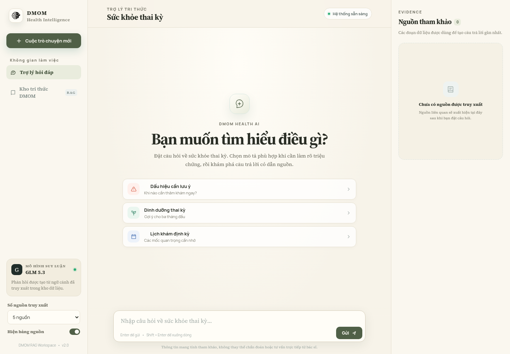

# DMOM Chatbot

Official Code for the Paper [VPHQA_ VIETNAMESE PREGNANCY HEALTH QUESTION ANSWERING DATASET](https://idl-bnc-idrc.dspacedirect.org/server/api/core/bitstreams/0c6bede1-44cc-423f-b35e-4efde1f1faa4/content)

This project builds a Retrieval Augmented Generation (RAG) pipeline over the `tungedng2710/Dmom_dataset` dataset using a local vector database (Chroma) and GLM 5.3 served through an OpenAI-compatible vLLM endpoint.

## Demo

[Open the live DMOM Health AI demo](https://7866--main--frontier--idp-lab.coder.vts-ai.space)

[](https://7866--main--frontier--idp-lab.coder.vts-ai.space)

Key choices:
- Vector DB: Chroma (local persistent store)
- Embeddings: via Ollama `/api/embeddings` (default: `bge-m3:latest`)
- Generator: GLM 5.3 (`glm53-flash`) through vLLM
- Dataset: `tungedng2710/Dmom_dataset` (fetched with `datasets`)

Prerequisites
- Python 3.9+
- `pip`
- Ollama installed and running at `http://localhost:7860` for embeddings
- Access to the configured GLM 5.3 vLLM endpoint

Install Ollama
- Linux:
  - `curl -fsSL https://ollama.com/install.sh | sh`
  - Start on port 7860: `export OLLAMA_HOST=0.0.0.0:7860 && ollama serve`
- macOS:
  - `brew install ollama` (or download the app from ollama.com)
  - Start on port 7860: `export OLLAMA_HOST=0.0.0.0:7860 && ollama serve`
- Windows:
  - Install the Ollama app from ollama.com or via `winget install Ollama.Ollama`
  - Run it once, then in a terminal: `setx OLLAMA_HOST 0.0.0.0:7860` and restart Ollama (or use WSL with the Linux command above).
- Docker (optional):
  - `docker run -d --name ollama -p 7860:11434 -v ollama:/root/.ollama ollama/ollama`
  - The API is then available at `http://localhost:7860` (mapped to container’s 11434).

Verify Ollama
- `curl http://localhost:7860/api/tags` should return JSON (empty if no models yet).

Pull required models
- Embeddings (default `bge-m3:latest`):
  - `ollama pull bge-m3:latest`

Install
```
python -m venv .venv
source .venv/bin/activate
pip install -r requirements.txt
```

Configure
- Copy `.env.example` to `.env` and adjust values.
- Defaults:
  - `OLLAMA_BASE_URL=http://localhost:7860`
  - `VLLM_BASE_URL=http://171.232.252.135:31585/v1`
  - `VLLM_MODEL=glm53-flash`
  - `VLLM_API_KEY=<bearer token>`
  - `EMBEDDING_MODEL=bge-m3:latest`
  - `CHROMA_DIR=./data/chroma_dmom`
  - `CHROMA_COLLECTION=dmom_qa`

Commands

1) Ingest from local CSV (recommended for dmom_data.csv)
```
python -m tonrag.cli ingest \
  --csv data/dmom_data.csv \
  --text-field Reference \
  --id-field no \
  --chunk-size 800 \
  --chunk-overlap 120
```

2) Ingest from Hugging Face dataset
```
python -m tonrag.cli ingest \
  --dataset tungedng2710/Dmom_dataset \
  --split train \
  --text-field context \
  --id-field id \
  --chunk-size 800 \
  --chunk-overlap 120
```

Notes:
- If you are unsure of field names, run:
  - CSV: `python -m tonrag.cli inspect --csv data/dmom_data.csv`
  - HF: `python -m tonrag.cli inspect --dataset tungedng2710/Dmom_dataset --split train`
- The script tries a few sensible defaults and will suggest possible column names.

3) Answer a single question
```
python -m tonrag.cli query \
  --question "<your question>" \
  --top-k 5
```

4) Evaluate on the dataset (quick lexical match)
```
# CSV example
python -m tonrag.cli eval \
  --csv data/dmom_data.csv \
  --question-field instruction \
  --answer-field output \
  --top-k 5 \
  --limit 50

# HF example
python -m tonrag.cli eval \
  --dataset tungedng2710/Dmom_dataset \
  --split validation \
  --question-field question \
  --answer-field answer \
  --top-k 5 \
  --limit 50
```

Project Structure
- `tonrag/config.py` – environment/config defaults
- `tonrag/embeddings.py` – Ollama embeddings client; ST fallback if available
- `tonrag/llm.py` – OpenAI-compatible GLM 5.3 vLLM client
- `tonrag/vectorstore.py` – Chroma wrapper
- `tonrag/dataset.py` – dataset utilities and column auto-detection
- `tonrag/chunking.py` – simple text chunker
- `tonrag/rag.py` – retrieval + prompt assembly + generation
- `tonrag/cli.py` – CLI entry points (ingest/query/eval/inspect)
- `app/server.py` – minimal web app (stdlib) serving `app/static/` and `/api/chat`
- `app/static/` – frontend assets (index.html, style.css, app.js)

Troubleshooting
- If embeddings fail, ensure the embedding model is pulled and available in Ollama: `ollama pull bge-m3:latest`.
- If generation fails, verify `VLLM_BASE_URL`, `VLLM_MODEL`, and `VLLM_API_KEY`.
- If dataset download fails, ensure your environment has internet access and the `datasets` package can reach Hugging Face.

Web App
- FastAPI server (recommended): `uvicorn app.main:app --host 0.0.0.0 --port 7865`
- Open: `http://localhost:7865`
- Endpoints:
  - `GET /` – serves UI
  - `POST /api/chat` – body: `{ "message": "...", "top_k": 5 }`
  - `GET /health`
- The app uses the same RAG pipeline and Chroma store.

Docker Compose
```
# Ensure .env contains VLLM_API_KEY and data/chroma_dmom has been built with
# `python scripts/build_vector_db.py`.
docker compose up --build -d

# Check status and follow logs.
docker compose ps
docker compose logs -f app
```

Open `http://localhost:7865`. Stop the service with `docker compose down`.
The container uses `requirements.docker.txt`; offline ingestion and evaluation
dependencies remain in `requirements.txt` and are not added to the runtime image.
Docker Compose keeps Chroma's local ONNX embedding model in a named volume so it
is downloaded only once. The container uses `CHROMA_QUERY_MODE=text`, so it does
not require an Ollama service for queries.

Legacy stdlib server (optional): `python app/server.py --port 7865`

Chat UI
- Responsive three-panel workspace with evidence cards, status, and copy actions.
- Shift+Enter for newline, Enter to send, clear chat, and adjustable Top-K.
- Answers render Markdown (headings, lists, links, code blocks) safely in the UI.
- CLI: add `--strip-markdown` to print plain‑text answers.

License
- For this template, no explicit license is added; adapt as needed.
